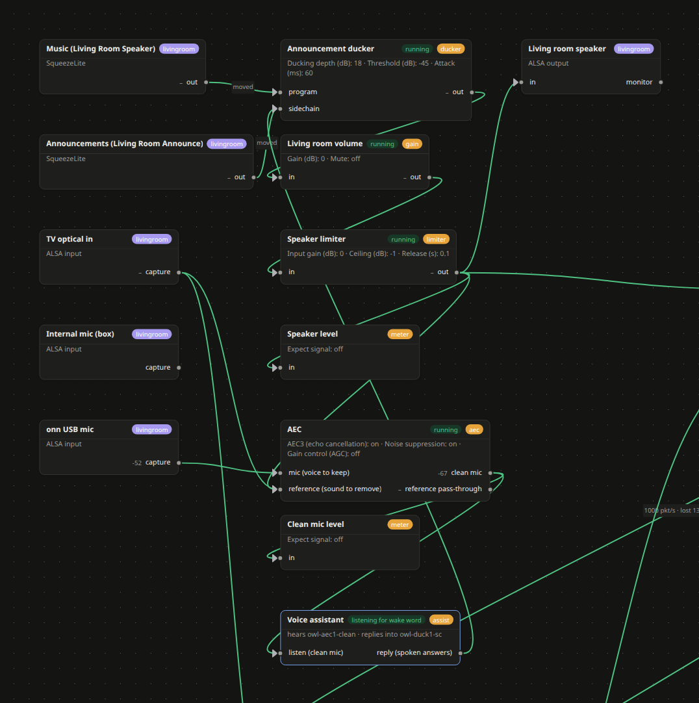

# Owl Designer

A Q-SYS-style designer for the audio of your whole house: every speaker, microphone, app and camera of every machine
running **owl-node**, on one canvas, wired by drag and drop — with processing blocks, an echo canceller and a Home
Assistant voice satellite.

## How it is split

Audio processing needs a machine with real sound hardware and some CPU; many Home Assistant hosts are neither. So:

- **This add-on** runs the designer and the Routing page, here in the sidebar (Home Assistant signs you in).
- **The engine (the hub)** runs on a Linux machine you choose: `owl-node/install.sh --hub` from
  [the repository](https://github.com/MorningstarOwl/owl-designer). It holds the audio graph, the processing blocks,
  the NMOS registry and the voice satellite.
- **Nodes** are your other machines (`owl-node/install.sh`); add them in the designer's **Nodes** box by IP.

## Configuration

| Option | |
|---|---|
| `engine_url` | Your hub, e.g. `192.0.2.10` (port 8362 is assumed) or `http://192.0.2.10:8362`. Required. |
| `registry_url` | Optional. The NMOS registry for the Routing page; empty = the hub on port 8010. |

**Network:** port 8361 is off by default. Give it a port to open the designer on your network without Home
Assistant's login.

## First steps

1. Set `engine_url`, start the add-on, enable **Show in sidebar**, open **Owl Designer**.
2. **Nodes** → type each machine's IP → **Add**. Its devices appear on the canvas.
3. Add blocks from the palette, wire them, press **Deploy…** (it shows every change first and rolls back on failure).
   Devices are added to the canvas from the **Devices** list on the left. **Organize** tidies the canvas; boxes, notes
   and signal names (select a wire) keep a large design readable. Ctrl+Z undoes.
4. **Run** shows live meters; drag **🎧 Probe** onto any port to hear it in your browser; **Panels** make phone pages
   of controls.

## With Home Assistant

- **Entities:** the hub publishes every named control and meter over MQTT (Mosquitto add-on). Give the hub the broker
  once: `install.sh --hub --mqtt mqtt://user:password@<broker>:1883`.
- **Voice:** the hub is a Wyoming satellite. Home Assistant discovers it; choose the Assist pipeline and wake word on
  the device. In the designer, wire the echo canceller's *clean mic* into the **Voice assistant** block.

## Troubleshooting

- **"Cannot reach the engine"** on the page: `engine_url` is wrong or the hub is not running; the add-on's log says
  which address it tried.
- **Video previews** stream from the hub directly (WebRTC), so they work on your home network, not through Home
  Assistant's remote access; browsers generally need H.264 for them.

More: [README](https://github.com/MorningstarOwl/owl-designer#readme).
